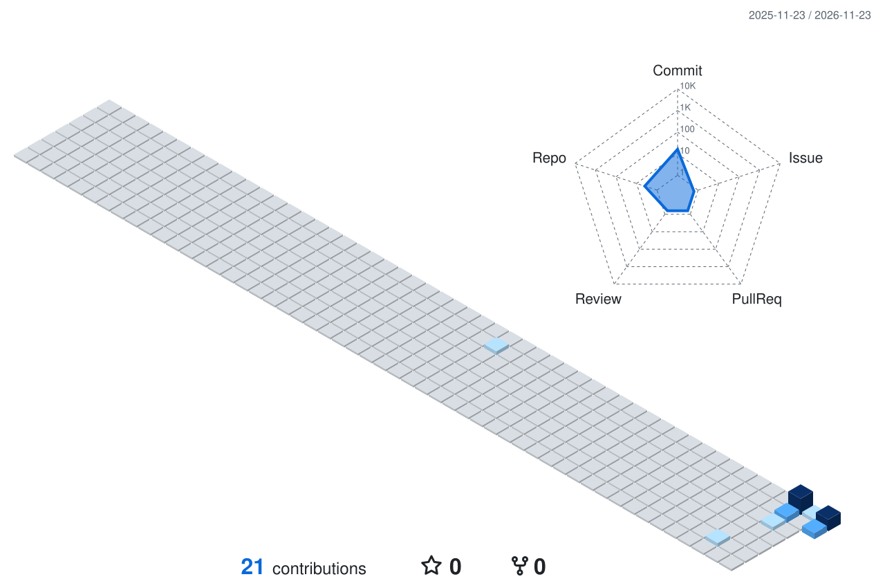

<h1 align="center">Matthew Junkins</h1>

<strong>I build tools for security monitoring, detection engineering, and AI evaluation.</strong>

  
  
  

  <a href="#toolbox">Toolbox</a> · <a href="#featured-projects">Featured Projects</a> · <a href="#connect">Connect</a>

## About

I’m a PC technician at Dominion Energy and a Cyber Security and Networking graduate from Shepherd University. I troubleshoot Windows and network issues, and write guides that help coworkers use internal AI tools.

My projects look at how to spot suspicious activity and make the results easier to investigate. I also evaluate AI-generated code and reasoning by comparing the model’s claims with the test output and the code changes.

## Toolbox
**Languages**

  

**Frameworks & Libraries**

  

**Cloud & DevOps**

  

**Systems**

  

**Security**

  
  
  
  
  
  
  

## Featured Projects
| Project | What it is | Stack |
|---|---|---|
| [Workflow Injection Guard](https://github.com/MatthewJunkins445/workflow-injection-guard) Application security | Flags risky GitHub Actions patterns on the lines a pull request changes, using custom Semgrep rules with test fixtures and end-to-end checks. | GitHub Actions + Semgrep + Python |
| [L.O.G.S.](https://github.com/MatthewJunkins445/L.O.G.S.) Network monitoring | A desktop dashboard that shows network exposure, firewall findings, and live traffic alerts in one place. | React + Tauri + FastAPI + Python |
| Network Security Policy Simulator Team capstone | A prototype for testing firewall policies and visualizing their effects. | Network simulation + Policy testing |

## Detection Engineering
| Detection | Data source | ATT&CK |
|---|---|---|
| Suspicious PowerShell execution | Sysmon → Splunk | [T1059.001](https://attack.mitre.org/techniques/T1059/001/) |
| SSH brute-force attempts | SSH auth logs → Splunk | [T1110](https://attack.mitre.org/techniques/T1110/) |
| Network anomaly alerts | Live traffic → [L.O.G.S.](https://github.com/MatthewJunkins445/L.O.G.S.) | — |

## 3D Commit History
<!--
  Regenerated daily by .github/workflows/profile-3d.yml.
  Colors live in .github/profile-3d-settings.json (cyan -> violet, with a dark-mode palette).
-->

  

## Connect
- [LinkedIn](https://www.linkedin.com/in/matthew-junkins-21809b268)
- [Email](mailto:mjunkins445@gmail.com)
- [GitHub](https://github.com/MatthewJunkins445?tab=repositories)
