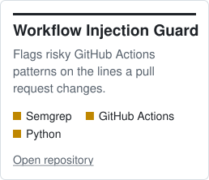
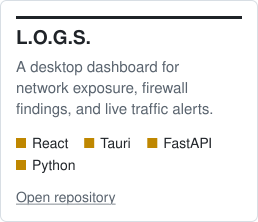
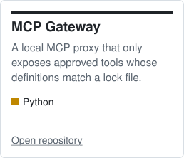

<picture>
  <source media="(prefers-color-scheme: dark)" srcset="./assets/header-dark.svg">
  
</picture>

I build tools for security monitoring, detection engineering, and AI evaluation.

I'm a PC technician at Dominion Energy and a 2026 Cyber Security and Networking graduate from Shepherd University. At work I troubleshoot Windows and network issues, and I write guides that help coworkers use internal AI tools.

On my own time I build ways to spot suspicious activity and make it easier to investigate. I also evaluate AI-generated code and reasoning by checking what a model claims against the test output and the actual code changes.

I'm looking for entry-level roles in security operations, detection engineering, and AI evaluation. Reach me on [LinkedIn](https://www.linkedin.com/in/matthew-junkins-21809b268) or by [email](mailto:mjunkins445@gmail.com).

## Tools and pinned projects

<picture>
  <source media="(prefers-color-scheme: dark)" srcset="./assets/tools-dark.svg">
  
</picture>

<a href="https://github.com/MatthewJunkins445/workflow-injection-guard"><picture><source media="(prefers-color-scheme: dark)" srcset="./assets/pin-wig-dark.svg"></picture></a>
<a href="https://github.com/MatthewJunkins445/L.O.G.S."><picture><source media="(prefers-color-scheme: dark)" srcset="./assets/pin-logs-dark.svg"></picture></a>
<a href="https://github.com/MatthewJunkins445/mcp-gateway"><picture><source media="(prefers-color-scheme: dark)" srcset="./assets/pin-mcp-dark.svg"></picture></a>

I also worked on a team capstone, a Network Security Policy Simulator for testing firewall policies and visualizing their effects.

## Detections

These are the highlighted squares in the header.

| Detection | Data source | ATT&CK |
|---|---|---|
| Suspicious PowerShell execution | Sysmon → Splunk | [T1059.001](https://attack.mitre.org/techniques/T1059/001/) |
| SSH brute-force attempts | SSH auth logs → Splunk | [T1110](https://attack.mitre.org/techniques/T1110/) |
| Network anomaly alerts | Live traffic → [L.O.G.S.](https://github.com/MatthewJunkins445/L.O.G.S.) | Not mapped |
